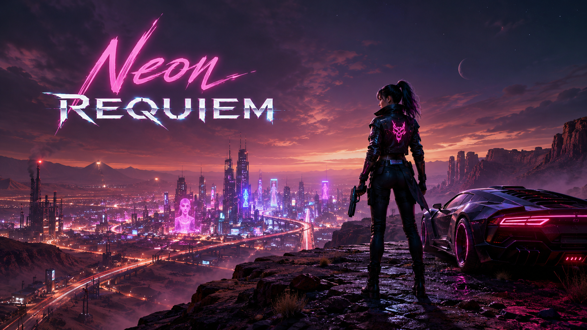

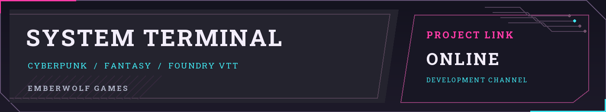

<h1 align="center">NEON REQUIEM</h1>
<p align="center"><strong>A Cyberpunk-Fantasy D&D 5e Game System for Foundry VTT</strong><br>Where fantasy meets the neon skyline.</p>
<p align="center">
  
  
  
  
  <a href="https://github.com/EmberWolf-Games/neon-requiem-dnd/actions/workflows/ci.yml"></a>
</p>

> [!IMPORTANT]
> **In development and not yet publicly released.** The first live Foundry v14 smoke test is pending.

<p align="center">
  <a href="#project-status">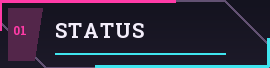</a>
  <a href="#project-vision--planned"></a>
  <a href="#installation">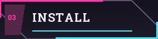</a>
  <a href="#development-setup">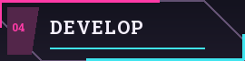</a>
  <a href="#documentation">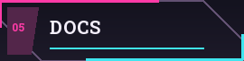</a>
</p>

---

**EmberWolf Games** · [`neon-requiem-dnd`](https://github.com/EmberWolf-Games/neon-requiem-dnd)

Neon Requiem is an independent Foundry VTT game system project built on the official D&D 5e system. The repository begins from the editable source for the official `dnd5e` v6.1.1 release and keeps its existing rules engine as the initial foundation.


## Project status

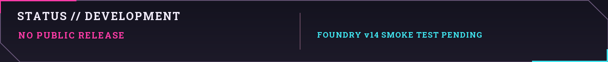

This repository is in its initial engineering setup. The upstream source, build tooling, four-part version controls, CI, release workflow, and project documentation are being established. No Neon Requiem release has been published, and a live Foundry v14 smoke test and version-comparison check have not been completed. The system is **not yet validated as playable or publicly installable**.

| Available in this repository | Still pending |
|---|---|
| Editable source from official `dnd5e` v6.1.1 (`release-6.1.1`, commit `bc1b2c921e2f306dc5079f8de883ad64607118a6`) | Live Foundry v14 installation, world smoke test, and four-part version comparison |
| Foundry Game System manifest with ID `neon-requiem-dnd` | Confirmation of every inherited workflow under the renamed system ID |
| Upstream Rollup, Less, and compendium build tools | Replacement or separate clearance for excluded upstream artwork |
| Four-part version utility, tests, documentation, and GitHub Actions workflows | Custom Neon Requiem setting and gameplay work |

The repository contains inherited D&D 5e code and SRD source content, but this status does not claim that the derivative has passed in-app validation. No custom cyberpunk mechanics, character progression changes, or sheet redesigns are part of this setup phase.

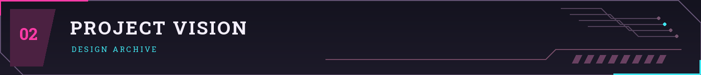

## Project vision — planned

The following are design goals and approved requirements, not implemented functionality:

- A cyberpunk-themed Foundry interface.
- A Character Identity Creator with male and female Human and Synth body bases.
- Selectable true-overhead hairstyles and mask-based skin and hair recoloring.
- Personalized animated WebM scene tokens with idle, walking, unconscious, and death states.

See the [approved Character Creator and Animation addendum](docs/project/gdd/Neon_Requiem_GDD_Character_Creator_Animation_Addendum_v2.md) for the design.

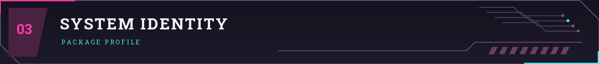

## System details

- **Foundry package type:** Game System, not a module
- **System identifier:** `neon-requiem-dnd`
- **Publisher:** EmberWolf Games
- **Current system version:** `0.1.1.000` (initial setup baseline; unpublished)
- **Foundry target:** v14+, with an initial minimum of `14.367`
- **Source foundation:** official Foundry D&D 5e v6.1.1
- **Primary language:** JavaScript ES Modules

The system has its own Foundry package identity and does not declare the official `dnd5e` system as a runtime dependency. Some upstream internal keys and document data retain the `dnd5e` namespace to preserve the inherited data schema; that namespace does not mean the official system must be installed.

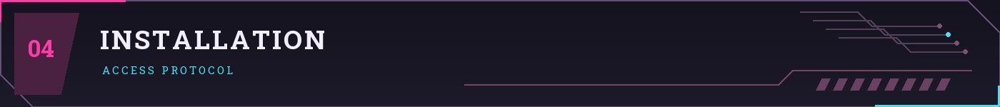

## Installation

There is no public Neon Requiem release yet. The stable manifest endpoint is reserved for published releases and will be populated by the release workflow after the first authorized release. Do not use it as an install source until a release is announced.

After a release is published, install it in Foundry from **Setup → Game Systems → Install System** using:

```text
https://raw.githubusercontent.com/EmberWolf-Games/neon-requiem-dnd/stable/system.json
```

For local development, the build stages `dist/package/` and produces a ZIP with `system.json` at its root, without an extra enclosing directory. The owner's live acceptance test will install through the GitHub manifest. See the [smoke-test guide](docs/SMOKE-TESTING.md).


## Development setup

Use Node.js `24.15.0` and npm `11.7.0` or compatible versions. The project follows the EmberWolf Games Foundry System template conventions and keeps the upstream dependency lockfile.

```powershell
npm ci --ignore-scripts
npm run check:version
npm run check:manifest
npm run check:assets
npm test
npm run lint
npm run build
npm run package
npm run check:package
```

`npm run build` uses the upstream Rollup, Less, and Foundry compendium packaging commands. Generated CSS, compiled JavaScript, packed compendia, and distribution files are ignored by Git. See [Development](docs/DEVELOPMENT.md) for details.

## Versioning

Foundry system versions use EmberWolf Games' strict `M.m.r.b` convention, with a three-digit Build component. `system.json` is the only version source of truth; npm metadata does not contain this four-part value.

```text
npm run version -- show
npm run version -- minor
npm run version -- release
npm run version -- prepare-build
```

The initial version is `0.1.1.000`. A Major change requires explicit approval and a recorded Minor transition decision. See [Versioning](docs/VERSIONING.md).

## Build, tests, and release

Run `npm test`, `npm run lint`, the manifest and asset checks, then `npm run build` and the package checks before submitting changes. CI repeats these checks on pull requests and pushes.

The release workflow is a manually controlled workflow. It validates the current system version and release tag, builds and verifies the package, publishes a GitHub Release, validates its public assets, then updates the stable manifest branch. No release is created as part of this repository setup. See [Releasing](docs/RELEASING.md).

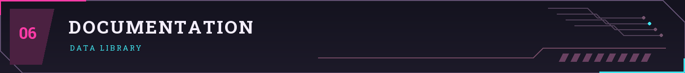

## Documentation

| Explore | Reference |
|---|---|
| Project decisions and handoffs | [Project hub](docs/project/README.md) |
| Local setup and builds | [Development](docs/DEVELOPMENT.md) · [Foundry v14 smoke test](docs/SMOKE-TESTING.md) |
| Version and release policy | [Versioning](docs/VERSIONING.md) · [Releasing](docs/RELEASING.md) |
| Working together and attribution | [Contributing](CONTRIBUTING.md) · [Third-party notices](THIRD-PARTY-NOTICES.md) |


## Repository layout

| Path | Purpose |
|---|---|
| `system.json` | Foundry Game System manifest and canonical system version |
| `dnd5e.mjs`, `module/`, `templates/`, `less/`, `lang/` | Inherited system source and presentation files |
| `packs/_source/` | Editable upstream compendium source data |
| `scripts/`, `tests/` | Versioning, asset and manifest checks, packaging, and tests |
| `.github/workflows/` | CI and controlled release automation |
| `docs/` | Development, architecture, versioning, release, and upstream notes |
| `docs/project/` | Project decisions, approved GDD addenda, team instructions, and handoffs ([index](docs/project/README.md)) |
| `LICENSE`, `LICENSE.txt`, `LICENSES/`, asset `LICENSE` files | EmberWolf, upstream, and third-party license notices |

## Contributing

Please read [CONTRIBUTING.md](CONTRIBUTING.md) before opening a pull request. Keep upstream maintenance changes separate from future game design work, preserve third-party notices, and avoid broad replacements of the upstream `dnd5e` namespace.

## License and attribution

The repository's [EmberWolf Games MIT license](LICENSE) applies to EmberWolf Games contributions. The upstream software license and all applicable third-party notices are retained separately. SRD material is attributed to Wizards of the Coast LLC under CC BY 4.0; font and icon licenses remain with their files. Some upstream art has terms that do not allow use in this derivative and has been excluded. See [Third-Party Notices](THIRD-PARTY-NOTICES.md) and [Upstream](docs/UPSTREAM.md).

## Links

- [Foundry Virtual Tabletop](https://foundryvtt.com/)
- [Foundry developer documentation](https://foundryvtt.com/api/v14/)
- [Foundry system development introduction](https://foundryvtt.com/article/intro-development/)
- [Official Foundry D&D 5e source](https://github.com/foundryvtt/dnd5e)
- [Official D&D 5e v6.1.1 release](https://github.com/foundryvtt/dnd5e/releases/tag/release-6.1.1)
- [SRD 5.1](https://dnd.wizards.com/resources/systems-reference-document)
- [SRD 5.2](https://www.dndbeyond.com/srd)
- [Creative Commons Attribution 4.0 International](https://creativecommons.org/licenses/by/4.0/)
